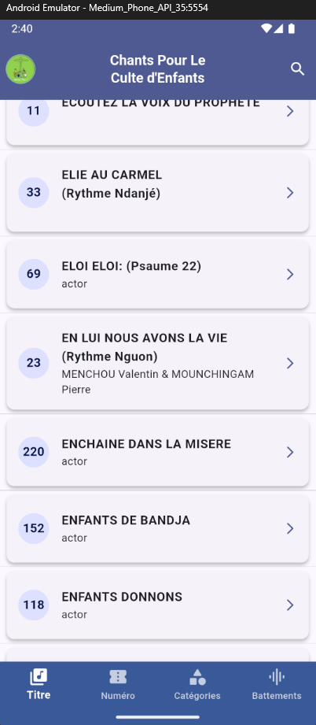

# 📖 Alleluia - Tome 1 (Application de chants)

**Alleluia Tome 1** est une application Flutter dédiée à la consultation, à l’écoute et à la gestion de chants religieux du Culte d'enfants de l'Eglise Evangélique du Cameroun. Elle permet de naviguer dans un recueil de **220 chants** via plusieurs modes : **Titre**, **Numéro**, **Catégorie**, **Battement**, et **Menu général**.

---
## 🏷️ Version & Aperçu
[](https://github.com/)  

### 📸 Capture d’écran



graph TD

UI[Flutter UI<br/>Pages & Widgets]

UI -->|utilise| HymnsRepo[HymnsRepository]
UI -->|utilise| FavRepo[FavoritesRepository]
UI -->|utilise| AudioService[AudioPlayerService]

HymnsRepo -->|lit| HymnDB[HymnDbScope]
FavRepo -->|lit/écrit| HymnDB

HymnDB -->|chargement initial| JsonSource[JSON Hymn Data Source]

JsonSource -->|parse via isolate| HymnModel[Hymn / Section / Line Models]

AudioService -->|joue| AudioFiles[Fichiers audio MP3]
----

graph LR

User[Utilisateur]

Device[Smartphone<br/>(Android / iOS)]
App[Alleluia App<br/>Flutter]

Assets[Assets embarqués<br/>JSON + MP3]

User --> Device
Device --> App
App --> Assets


---
## 🚀 Fonctionnalités principales

### 🏁 Démarrage
- **Écran de démarrage (`SplashScreen`)** : logo et image de fond.
- **Initialisation automatique** :
  - ouverture de la base locale Isar ;
  - insertion (seed) automatique des chants `legacy` à la première exécution.

### 🔀 Navigation
- **Accueil (`Home`)** avec barre de navigation inférieure (`CustomBottomNavBar`).
- Navigation fluide entre les pages :
  1. **Titre** – liste alphabétique (`PlayList`)
  2. **Numéro** – grille de numéros (`Numbers`)
  3. **Catégories** – regroupement par thème (`Category`)
  4. **Battements** – regroupement par rythme (`Battements`)
  5. **Menu général** – favoris, partage, avis, dons, etc.

### 🎧 Audio
- **Lecture audio intégrée** (via `AudioPlayerService`).
- Lecture locale depuis `assets/sound/`.
- Contrôles de lecture dans la page `PlayDetails` (lecture/pause/avancer/reculer).

### 🧱 Base de données locale (Isar)
- **Modèle structuré :**
  - `Hymn` (chant)
  - `Section` (couplet/refrain)
  - `Line` (ligne de texte)
- Stockage hors ligne performant avec indexation :
  - par numéro,
  - par titre,
  - par langue,
  - par catégories et battements.

### 🧩 Architecture modulaire
- `core/` → services généraux (DB, audio)
- `features/hymns/` → modèle, données et UI pour les chants
- `app/` → thème, configuration globale, page d’entrée

---
## 📁 Structure du projet
```
lib/
  app/
    app.dart
    theme/
      app_theme.dart
    presentation/
      pages/
        splash_screen.dart
  core/
    services/
      hymn_db_service.dart
      hymn_db_scope.dart
      audio_player_service.dart
      audio_service_scope.dart
  features/
    hymns/
      data/
        models/
          hymn.dart
          hymn_mapper.dart
        repositories/
          hymns_repository.dart
        source/
      presentation/
        pages/
          home_page.dart
          playlist_page.dart
          numbers_page.dart
          category_page.dart
          battements_page.dart
          settings_page.dart
        widgets/
          custom_bottom_navbar.dart
          custom_appbar.dart
assets/
  images/
  sound/
```

---
## 🧩 Technologies principales

| Type                | Librairie / outil               | Rôle                            |
| ------------------- | ------------------------------- | ------------------------------- |
| 🎨 UI               | Flutter / Material 3            | Interface et thèmes             |
| 🔊 Audio            | audioplayers                    | Lecture de fichiers locaux      |
| 🗃️ Base de données  | Isar + isar_flutter_libs        | Stockage local optimisé         |
| 🧭 Navigation       | Navigator / BottomNavigationBar | Gestion d’écran                 |
| 🧠 Code généré      | build_runner + isar_generator   | Génération des adaptateurs Isar |
| 📂 Fichiers locaux  | path_provider                   | Accès au stockage utilisateur   |

---
## ▶️ Lancer l’application

### 1. Installer les dépendances
```bash
flutter pub get
```

### 2. Générer les fichiers `.g.dart`
*(obligatoire après toute modification du modèle `hymn.dart`)*
```bash
flutter pub run build_runner build --delete-conflicting-outputs
```

### 3. Lancer l’application
```bash
flutter run
```

### Recréer le splash si modifié
```bash
flutter pub run flutter_native_splash:create
```

---
## ⚙️ Pubspec (extrait)

```yaml
environment:
  sdk: ^3.8.1

dependencies:
  flutter:
    sdk: flutter
  cupertino_icons: ^1.0.8
  curved_navigation_bar: ^1.0.6
  font_awesome_flutter: ^10.9.1
  flutter_native_splash: ^2.4.7
  audioplayers: ^6.5.1
  isar: ^3.1.0+1
  isar_flutter_libs: ^3.1.0+1
  path_provider: ^2.1.5

dev_dependencies:
  flutter_test:
    sdk: flutter
  flutter_lints: ^5.0.0
  isar_generator: ^3.1.0+1
  build_runner: ^2.4.13
  analyzer: ^5.13.0
```

---
## 🧪 Qualité & tests (à venir)
* Tests unitaires pour :
  * `HymnsRepository`
  * `AudioPlayerService`
* Tests d’intégration : lecture et recherche.
* Golden tests pour l’UI (`CustomAppBar`, `PlayDetails`, etc.).

---
## 🗺️ Roadmap
* [x] Migration du modèle vers Isar
* [x] Seed automatique à la première exécution
* [x] Intégration du service audio
* [ ] Lecture des chants directement depuis Isar dans toutes les pages
* [ ] Page Favoris avec persistance locale
* [ ] Partage / “Donner un avis” / “Faire un don”
* [ ] Cache JSON exportable
* [ ] Internationalisation (l10n)
* [ ] Export / import de la base utilisateur

---
## 🤝 Contribuer
- Branches : `feat/*`, `fix/*`, `refactor/*`, `chore/*`.
- Pull Requests : petites, bien décrites, avec captures d’écran si possible.

---

## 📜 Licence
Projet éducatif et personnel.
Respecter les droits d’auteur des chants et des œuvres enregistrées.
