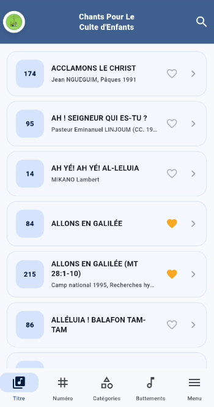
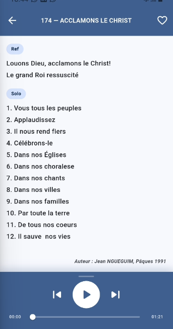

# 📖 Alleluia — Tome 1

**Alleluia Tome 1** est une application Flutter dédiée à la consultation, l'écoute et la gestion de chants religieux du Culte d'Enfants de l'Église Évangélique du Cameroun. Elle donne accès à un recueil de **220 chants** via cinq modes de navigation : **Titre**, **Numéro**, **Catégorie**, **Battement** et **Menu général**.

---

## 🏷️ Version & Aperçu

[](https://github.com/)
[](https://flutter.dev)
[](https://riverpod.dev)

### 📸 Capture d'écran


---

## 🚀 Fonctionnalités

### 🏁 Démarrage
- **Splash screen natif** (`flutter_native_splash`) + **splash Flutter animé** (`screen.png` en fondu).
- **Initialisation automatique** : ouverture de la base Isar et seed des 220 chants depuis le JSON à la première exécution.

### 🔀 Navigation
- **`NavigationBar` Material 3** avec 5 onglets persistants via `go_router` `ShellRoute`.
- Navigation fluide sans rechargement de la barre entre les onglets.

| Onglet | Page | Description |
|--------|------|-------------|
| Titre | `PlaylistPage` | Liste alphabétique des chants |
| Numéro | `NumbersPage` | Grille de numéros avec indicateur audio |
| Catégories | `CategoryPage` | Accordéon par temps liturgique et périodes |
| Battements | `BattementsPage` | Accordéon par rythme avec icônes |
| Menu | `SettingsPage` | Favoris, thème, partage, don |

### 🎧 Audio
- Lecture locale depuis `assets/sound/` via `AudioPlayerService`.
- Contrôles dans `PlayDetailsPage` : lecture/pause, précédent/suivant, slider de position.
- **Animation de transition fluide** : AppBar et player restent fixes, seules les paroles s'animent en slide horizontal lors du changement de chant.

### ❤️ Favoris
- Persistance locale via Isar (`Favorite` collection).
- Toggle depuis la liste, la page de détail ou la page Favoris.
- Mise à jour réactive instantanée sur toutes les pages.

### 🔍 Recherche
- Recherche globale par numéro, titre et paroles via `SearchDelegate`.
- Scoring de pertinence : match exact > titre > paroles.
- Debounce 300 ms natif Riverpod.

### 🎨 Thème
- **Material 3** avec `ColorScheme.fromSeed` (bleu + jaune).
- Basculement clair / automatique / sombre via `SegmentedButton` dans les paramètres.
- `AppColors` extension de thème pour les couleurs spécifiques à l'app.

---

## 📁 Structure du projet

```
lib/
  app/
    app.dart                        # MaterialApp.router + themeModeProvider
    themes/
      app_theme.dart                # AppTokens, AppColors, ThemeData light/dark
    presentation/
      pages/
        splash_screen.dart
  core/
    providers/
      hymn_db_service_provider.dart # Provider Isar (override dans main.dart)
      hymns_provider.dart           # 5 providers dérivés (liste, alpha, catégorie…)
      favorites_provider.dart       # AsyncNotifier + isFavoriteProvider
      search_provider.dart          # searchQueryProvider + searchResultsProvider
      audio_provider.dart           # StreamProviders depuis ValueNotifier
    routes/
      app_router.dart               # GoRouter + AppRoutes constants + ShellRoute
    services/
      hymn_db_service.dart          # Ouverture Isar
      audio_player_service.dart     # Lecture audio + ValueNotifier état
    utils/
      normalize.dart                # Normalisation texte pour la recherche
  features/
    data/
      models/
        hymn.dart                   # @collection Hymn, Section, Line, SectionType
        hymn.g.dart                 # Généré par isar_generator
        favorite.dart               # @collection Favorite
        favorite.g.dart
        search_result.dart          # SearchResult (hymn + score + matchedLine)
      repositories/
        hymns_repository.dart       # getAll, getByNumber, prev/next, search
        favorites_repository.dart   # isFavorite, toggle, getAllFavoriteNumbers
      sources/
        json_hymn_data_source.dart  # Parsing JSON dans un Isolate (compute)
    presentation/
      pages/
        home_page.dart              # Shell : child + CustomBottomNavBar
        playlist_page.dart
        numbers_page.dart
        category_page.dart          # Inclut CategoryGroupPage
        battements_page.dart
        play_details_page.dart      # AnimatedSwitcher paroles + player fixe
        settings_page.dart          # Inclut _FavoritesPage
        hymn_search_delegate.dart
      widgets/
        custom_appbar.dart
        custom_bottom_navbar.dart
        hymn_mini_card.dart
  main.dart                         # ProviderScope + override + seed
```

---

## 🧩 Technologies

| Type | Librairie | Rôle |
|------|-----------|------|
| 🎨 UI | Flutter / Material 3 | Interface, thèmes, animations |
| 🧠 State | `flutter_riverpod` ^2.6 | Providers, Notifiers, réactivité |
| 🧭 Navigation | `go_router` ^14 | Routing déclaratif, ShellRoute |
| 🔊 Audio | `audioplayers` ^6.5 | Lecture de fichiers locaux |
| 🗃️ Base de données | `isar` + `isar_flutter_libs` ^3.1 | Stockage local indexé |
| 🔤 Texte | `diacritic` | Normalisation accents pour la recherche |
| 📂 Chemins | `path_provider` | Accès au stockage utilisateur |
| 🖼️ Splash | `flutter_native_splash` | Splash natif Android/iOS |

---

## ▶️ Lancer l'application

### 1. Installer les dépendances
```bash
flutter pub get
```

### 2. Générer les fichiers Isar
> Obligatoire après toute modification de `hymn.dart` ou `favorite.dart`
```bash
dart run build_runner build --delete-conflicting-outputs
```

### 3. Recréer le splash natif (si modifié dans `pubspec.yaml`)
```bash
dart run flutter_native_splash:create
```

### 4. Lancer
```bash
flutter run
```

---

## ⚙️ Pubspec (extrait)

```yaml
environment:
  sdk: ^3.8.1

dependencies:
  flutter_riverpod: ^2.6.1
  riverpod_annotation: ^2.6.1
  go_router: ^14.6.1
  audioplayers: ^6.5.1
  isar: ^3.1.0+1
  isar_flutter_libs: ^3.1.0+1
  path_provider: ^2.1.5
  diacritic: ^0.1.6
  flutter_native_splash: ^2.4.7
  google_fonts: ^6.2.1
  font_awesome_flutter: ^10.9.1

dev_dependencies:
  isar_generator: ^3.1.0+1
  riverpod_generator: ^2.6.1
  build_runner: ^2.4.13
  custom_lint: ^0.7.0
  riverpod_lint: ^2.6.1
```

---

## 🏛️ Principes d'architecture

- **Séparation des couches** : DB → Repository → Provider → Widget. Aucune logique métier dans les widgets.
- **Pas de `InheritedWidget` manuel** : les anciens `HymnDbScope` et `AudioServiceScope` sont remplacés par des providers Riverpod.
- **Dérivation des providers** : `hymnsSortedAlphaProvider`, `hymnsByCategoryProvider`, `hymnsByBeatProvider` dérivent tous de `hymnsProvider` — un seul appel DB.
- **Règle async** : toujours capturer `ref.read()` et `context` avant les `await`. Vérifier `mounted` après chaque `await`.
- **Navigation** : jamais de `Navigator.push` direct — toujours `context.go()` ou `context.push()` via go_router.

---

## 🗺️ Roadmap

- [x] Architecture Riverpod + go_router
- [x] Navigation Material 3 (NavigationBar + ShellRoute)
- [x] Recherche globale avec scoring
- [x] Favoris persistants et réactifs
- [x] Lecteur audio avec animation de transition
- [x] Thème clair / sombre / automatique
- [ ] Persistance du thème choisi (`shared_preferences`)
- [ ] Partage de chants (`share_plus`)
- [ ] Taille de police réglable dans les paroles
- [ ] Tests unitaires (`HymnsRepository`, `FavoritesNotifier`)
- [ ] Publication Play Store (signing, release build)
- [ ] Internationalisation (`flutter_localizations`)

---

## 🧪 Qualité & Tests (à venir)

- Tests unitaires : `HymnsRepository`, `FavoritesNotifier`, `normalizeText`
- Tests d'intégration : seed, recherche, lecture audio
- Golden tests : `CustomAppBar`, `PlayDetailsPage`, `NumbersPage`

---

## 🤝 Contribuer

- Branches : `feat/*`, `fix/*`, `refactor/*`, `chore/*`
- Pull Requests : petites, bien décrites, avec captures d'écran si possible

---

## 📜 Licence

Projet éducatif et personnel — Église Évangélique du Cameroun.  
Respecter les droits d'auteur des chants et des œuvres enregistrées.
